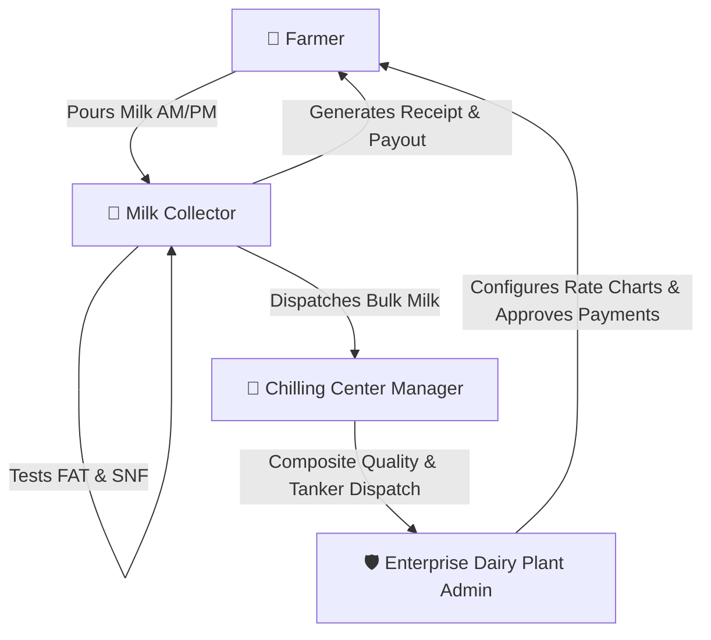

# 🥛 Farm2Factory (F2F)

> **Next-Generation Dairy Supply Chain & Milk Collection Management Platform**  
> Connecting Farmers, Village Milk Collectors, Chilling Center Managers, and Enterprise Dairy Plants into a unified, real-time ecosystem.

---

## 🌟 Overview

**Farm2Factory** is a production-grade, multi-platform Flutter application engineered for modern dairy enterprises. It digitizes the end-to-end milk collection lifecycle—from the moment raw milk is poured into analyzers at village collection centers to bulk chilling, dispatch logistics, quality inspection, and centralized dairy factory intake.

### 🎯 Key Problems Solved
- **Transparent Quality & Payouts**: Eliminates manual ledger disputes by computing live FAT% and SNF% rate charts for Cow and Buffalo milk on the spot.
- **End-to-End Traceability**: Real-time tracking of morning and evening collection batches, tanker dispatches, and chilling plant reconciliation.
- **Stakeholder Accessibility**: Dedicated responsive portals tailored for mobile, tablet, and desktop viewports with 4 distinct theme modes.
- **Enterprise Security**: 2FA-protected console for plant administrators managing sensitive rate charts and financial disbursements.

---

## 👥 Stakeholder Portals & Capabilities



### 1. 🌾 Farmer Portal
- **Daily Sell Log**: View morning and evening shift entries with exact quantity (Litres), FAT%, and SNF%.
- **Live Rate Transparency**: Understand how rates per litre are computed based on active pricing policies.
- **Passbook & Payments**: Track disbursed, pending, and upcoming dairy payments with transaction IDs.
- **Quality Trends**: Graphical breakdown of milk grade (Grade A / B / C) and purity checks.

### 2. 🥛 Milk Collector Portal
- **Rapid Intake Recording**: Record milk intake in seconds with quick Cow/Buffalo toggles, volume inputs, and automatic rate lookups.
- **Farmer Management**: Search, register, and manage village farmers with referral invite links.
- **Real-Time Payout Banners**: Immediate visibility into today's total intake and total payout amount.
- **Offline-First & Responsive**: Designed for field use on handheld smartphones and tablets.

### 3. 🏢 Chilling Center Manager Portal
- **Center Operations Dashboard**: Monitor active collectors, daily aggregated volume, and chilling tank temperatures.
- **Dispatch Management**: Create and track milk tankers, assign drivers, log seal numbers, and record dispatch timestamps.
- **Composite Quality Testing**: Run batch analyzer tests prior to factory dispatch.
- **Rate Chart Inspector**: Review operational rate matrices assigned by headquarters.

### 4. 🛡️ Enterprise Dairy Plant Admin Console
- **2FA Guarded Console**: Protected by Two-Factor Authentication session security to prevent unauthorized pricing or payout edits.
- **Centralized Intake Overview**: Live tracking of intake volume across all affiliated chilling centers (e.g., 40,000+ L/day).
- **Dynamic Rate Chart Engine**: Comprehensive FAT & SNF pricing matrices for Cow and Buffalo milk with instant policy activation.
- **Reports & Exporting**: Generate and export operational, payment, and quality summaries (Excel/CSV and printable formats).
- **Location & Fleet Directory**: Comprehensive management of processing plants, chilling centers, and transport vehicles.

---

## 🎨 Design System & Theme Engine

Farm2Factory features an executive Material 3 design system with responsive typography, micro-animations, and high-contrast accessibility.

| Theme Mode | Description | Visual Characteristics |
| :--- | :--- | :--- |
| ☀️ **Light Mode** | Executive dairy canvas | Warm cream & milk surfaces (`#FAF7F4`), crisp emerald headers, obsidian slate typography. |
| 🌙 **Dark Mode** | Midnight Obsidian | Deep OLED backgrounds (`#0B1120`), slate card surfaces (`#1E293B`), and luminous emerald accents (`#10B981`). |
| 🍑 **Warm Peach Mode** | Cozy harvest glow | Soft peach milk surfaces (`#FFF7F2`), warm terracotta typography (`#3E1D13`), and peach borders. |
| ⚙️ **System Auto** | Responsive adaptive | Dynamically synchronizes with the host operating system's light/dark brightness settings. |

> **Theme Switcher**: Tap the theme icon in any portal's top bar to cycle modes, or long-press to open the **Appearance & Theme** modal dialog.

---

## 🛠️ Technology Stack

- **Framework**: [Flutter](https://flutter.dev/) (Channel stable, Material 3)
- **Language**: [Dart 3](https://dart.dev/)
- **Routing**: [go_router](https://pub.dev/packages/go_router) (Declarative routing with redirect guards and 2FA authentication state listening)
- **Backend & Cloud**:
  - [Firebase Core](https://firebase.google.com/)
  - [Cloud Firestore](https://firebase.google.com/docs/firestore) (Real-time data synchronization)
  - [Firebase Auth](https://firebase.google.com/docs/auth) (Role-based authentication)
- **Persistence**: [shared_preferences](https://pub.dev/packages/shared_preferences) (Theme and user preference caching)
- **State Management**: Reactive `ListenableBuilder` / `ChangeNotifier` repository pattern for lightweight, zero-boilerplate reactivity.

---

## 📂 Project Structure

```text
SW2627-DART-FLUTTER-Farm2Factory/
├── docs/
│   └── bug.md                  # Comprehensive bug resolution log and RCA
├── flutter_application_1/
│   ├── assets/
│   │   └── images/             # Vector illustrations, cow mascot, and branding assets
│   ├── lib/
│   │   ├── core/
│   │   │   ├── routes/         # go_router configuration & route guards
│   │   │   ├── theme/          # AppTheme tokens, light/dark/peach themes, ThemeController
│   │   │   ├── utils/          # Export helpers, call launchers, date formatters
│   │   │   └── widgets/        # Reusable widgets (AppLogo, ThemeModeButton)
│   │   ├── features/
│   │   │   ├── admin/          # Admin & Center Manager screens, repositories, and widgets
│   │   │   ├── auth/           # Login, Role-adaptive registration, 2FA guard, splash
│   │   │   ├── collector/      # Collector dashboard, milk entry recorder, reports
│   │   │   ├── farmer/         # Farmer self-service dashboard & profile
│   │   │   └── farmers/        # Farmer directory, profile details, and onboarding
│   │   ├── app.dart            # Root MaterialApp.router setup
│   │   └── main.dart           # App entrypoint & Firebase initialization
│   ├── pubspec.yaml            # Project dependencies and asset declarations
│   └── ...
└── README.md                   # Project documentation
```

---

## 🚀 Getting Started

### Prerequisites
- [Flutter SDK](https://docs.flutter.dev/get-started/install) (`^3.13.0` or higher)
- [Dart SDK](https://dart.dev/get-dart) (`^3.0.0`)
- Google Chrome (for Web development) or an Android / iOS device / simulator

### Installation & Run

1. **Clone the repository**:
   ```bash
   git clone https://github.com/your-username/SW2627-DART-FLUTTER-Farm2Factory.git
   cd SW2627-DART-FLUTTER-Farm2Factory/flutter_application_1
   ```

2. **Install dependencies**:
   ```bash
   flutter pub get
   ```

3. **Verify code quality**:
   ```bash
   flutter analyze
   ```

4. **Launch the application**:
   - **Chrome (Web)**:
     ```bash
     flutter run -d chrome
     ```
   - **Android Emulator / Device**:
     ```bash
     flutter run -d android
     ```
   - **Windows Desktop**:
     ```bash
     flutter run -d windows
     ```

---

## 🧪 Testing & Code Quality

The codebase enforces strict linting via `flutter_lints` and modular design patterns:
```bash
# Run static code analysis
flutter analyze

# Run unit and widget test suite
flutter test
```

---

## 📄 Bug Tracking & Quality Assurance

Refer to [`docs/bug.md`](docs/bug.md) for detailed root cause analyses, visual evidence, and architectural resolutions for past issues, including:
- **BUG-AUTH-001**: Role-Adaptive registration for Farmers, Collectors, and Dairy Admins.
- **BUG-UI-002**: Narrow viewport button overflow prevention via `Expanded` + `FittedBox`.
- **BUG-UI-003**: 23px RenderFlex bottom overflow resolution in the Theme Selection Bottom Sheet.
- **BUG-THEME-004**: High-contrast dark mode surface reconciliation & System Peach Theme integration.

---

## 📜 License

This project is proprietary and developed under the **Farm2Factory** initiative. All rights reserved.
